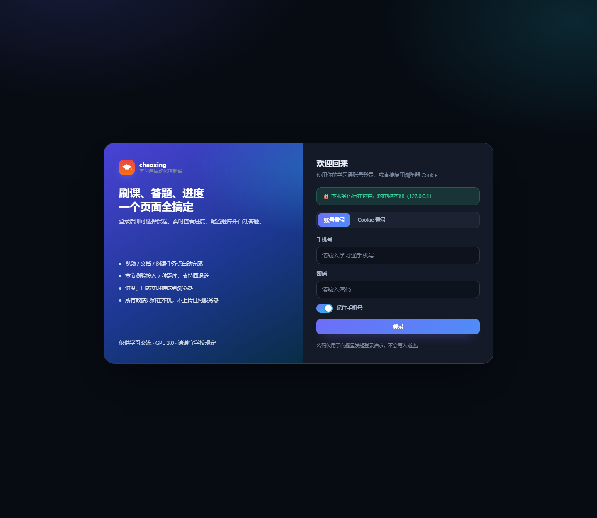
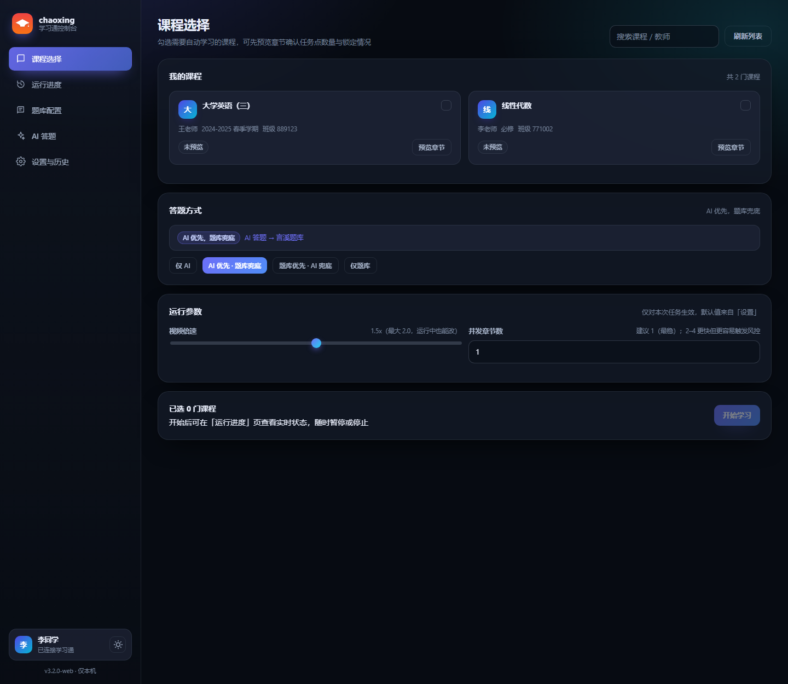
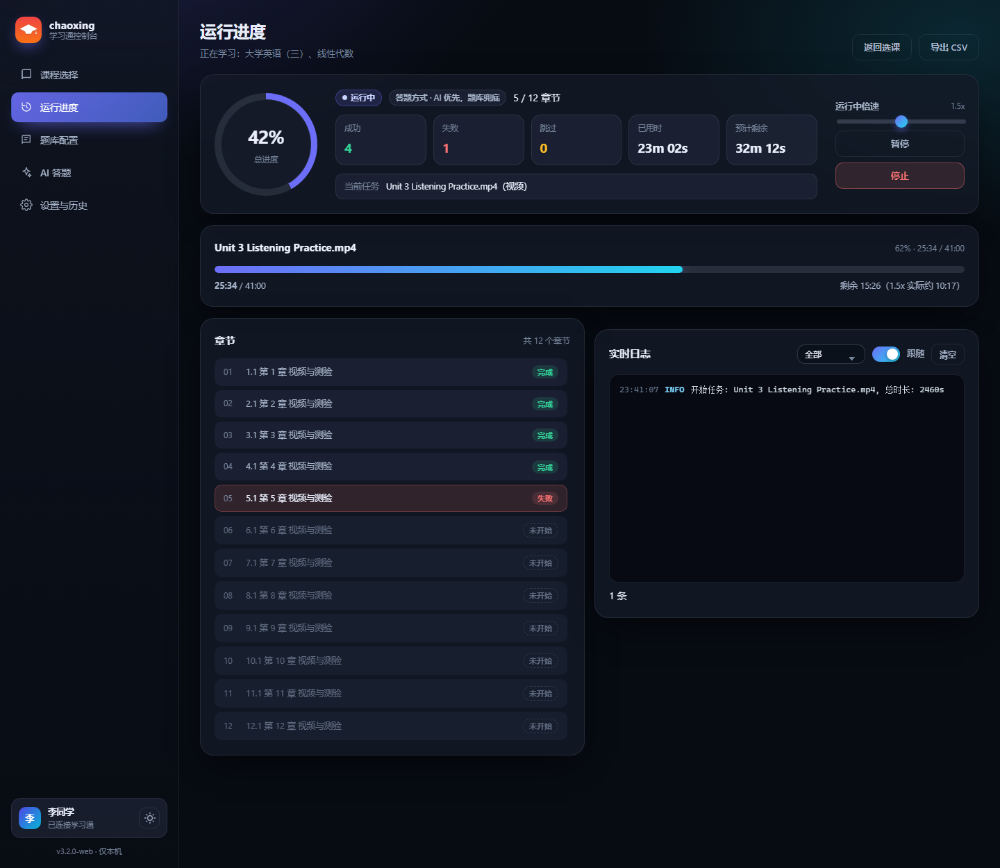
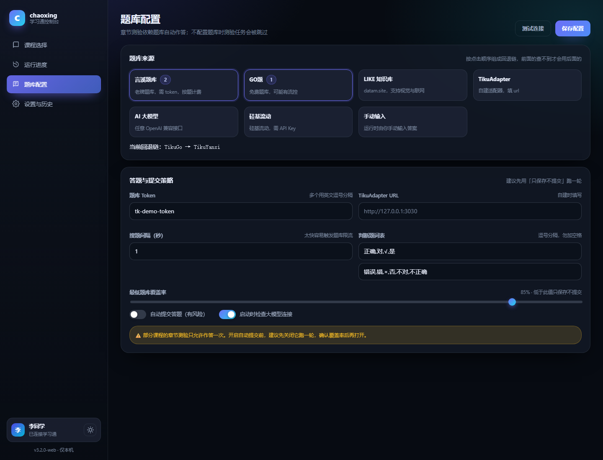
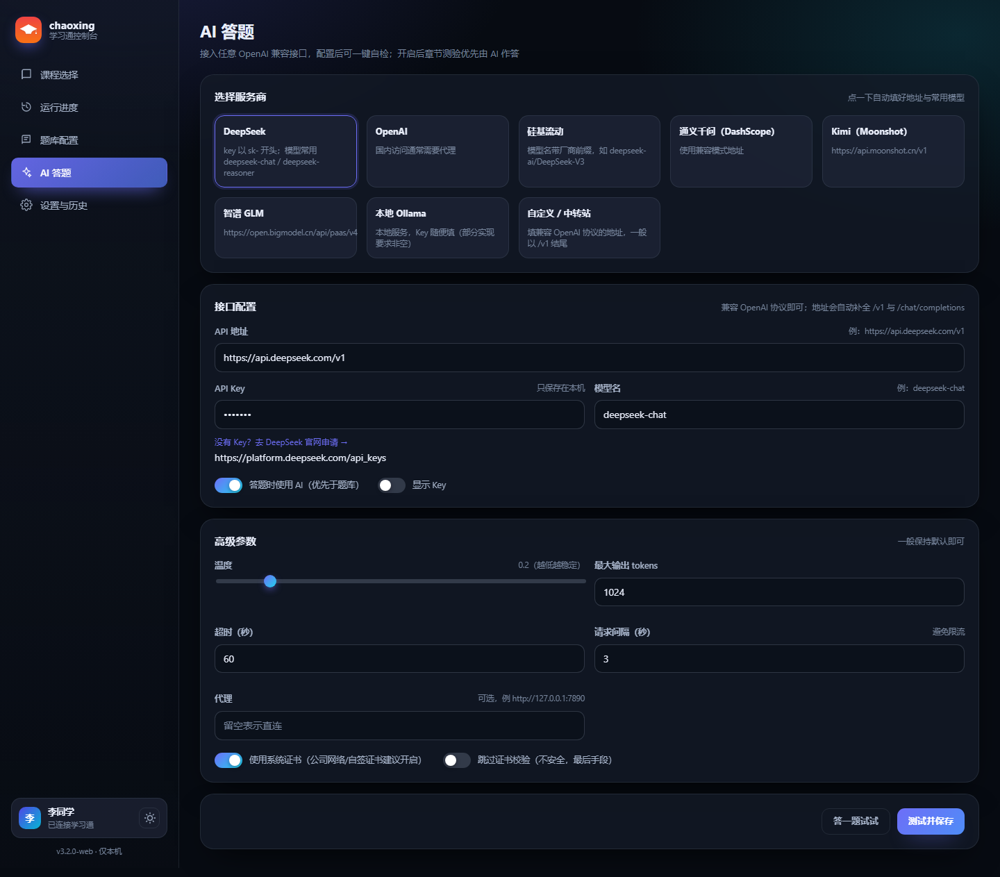
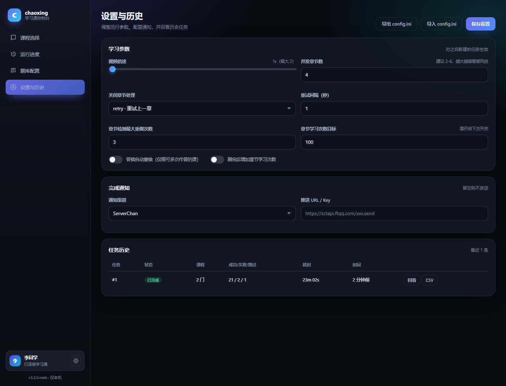

<div align="center">


# chaoxing 学习通控制台

**超星学习通 / 尔雅 / 泛雅 · 图形化自动刷课与答题**

不用命令行，浏览器里完成「登录 → 选课 → 刷课 → 配题库 / 接 AI → 看进度」全套流程。

[](https://www.python.org/)
[](LICENSE)
[](tests/)
[]()
[](web/static/js)

[功能特性](#-功能特性) · [快速开始](#-快速开始) · [界面导览](#-界面导览) · [答题与-AI](#-答题方式题库还是-ai) · [常见问题](#-常见问题) · [致谢](#-致谢)

</div>

---

> [!WARNING]
> 本项目仅供**学习交流**，请遵守所在学校的规章制度。使用本工具产生的一切后果由使用者自行承担。
> 作者与贡献者不对任何账号封禁、成绩异常负责。**请勿用于商业用途。**

## 📸 界面预览

<div align="center">

| 登录 | 课程选择 |
| :---: | :---: |
|  |  |

| 运行进度 | 题库配置 |
| :---: | :---: |
|  |  |

| AI 答题 | 设置与历史 |
| :---: | :---: |
|  |  |

</div>

## ✨ 这个分支做了什么

上游 [Samueli924/chaoxing](https://github.com/Samueli924/chaoxing) 是一个很强的命令行工具，但它只有终端界面：看进度靠 tqdm、改配置靠手写 ini、答题方式藏在 `provider` 字段里。

这个分支在**完全保留原 CLI** 的前提下，加了一整套本地 Web 控制台：

| 能力 | 上游 CLI | 本分支 |
| --- | :---: | :---: |
| 操作方式 | 命令行参数 / 交互输入 | **浏览器图形界面**（亦可继续用 CLI） |
| 进度 | 终端进度条 | **进度环 + 章节树 + SSE 实时日志** |
| 视频进度 | 只有一条进度条 | **总时长 / 已播放 / 剩余（含倍速折算）** |
| 暂停 / 停止 | 只能 Ctrl+C | **随时暂停、立即停止、停止后可继续** |
| 运行中调速 | 不支持 | **滑杆实时调整，下一任务点生效** |
| 章节可见性 | 跑到哪显示到哪 | **一开始就展示全部章节（含未开始）** |
| 题库配置 | 手写 ini | **图形化选择、排序回退链、一键连通性自检** |
| AI 答题 | 填 endpoint/key/model | **8 家预设 + 分步自检 + 失败原因诊断** |
| 历史记录 | 无 | **任务历史、CSV 导出、章节明细** |

## 🚀 功能特性

<table>
<tr><td width="50%" valign="top">

**🎬 自动完成任务点**
- 视频 / 音频（自动识别 Audio 回退）
- 文档、阅读、直播、空任务
- 视频倍速 1.0–2.0，运行中可调
- 并发章节数可调（**默认 1，最稳**）

**📊 实时进度**
- SSE 推送，毫秒级刷新
- 章节状态：完成 / 运行中 / 失败 / 跳过 / **未开始**
- 预计剩余时间按进度线性估算
- 日志过滤（全部 / 警告 / 错误）、跟随滚动

</td><td width="50%" valign="top">

**🧠 两种答题方式**
- 题库：言溪 / GO题 / LIKE / TikuAdapter / 硅基流动 / 手动
- AI：任意 OpenAI 兼容接口（DeepSeek、OpenAI、硅基流动、通义、Kimi、智谱、本地 Ollama、中转站）
- 可自由组合成回退链：`AI 优先 → 题库兜底`

**🛠 工程化**
- 原 CLI 100% 兼容
- 73 个单元测试
- PyInstaller 单文件打包
- 零前端构建链（原生 HTML5 + ES Modules，离线可用）

</td></tr>
</table>

## 📦 快速开始

### 方式一：下载可执行文件（推荐，免装 Python）

1. 到 [Releases](../../releases) 下载最新的 `chaoxing.exe`
2. 双击运行 —— 会弹出控制台并自动打开浏览器
3. 在网页里登录学习通即可

> [!IMPORTANT]
> **工作期间不要关闭那个控制台窗口**，它就是服务本体。
> 误点关闭会弹出确认框；最小化不影响使用。

### 方式二：源码运行

```bash
git clone <this-repo>
cd chaoxing-web-console
python -m venv .venv
.venv\Scripts\activate          # Windows
# source .venv/bin/activate     # macOS / Linux
pip install -r requirements.txt
python app.py                   # 自动打开 http://127.0.0.1:8848
```

需要 **Python 3.13+**（低于 3.13 建议用 `uv`）：

```bash
uv run --python 3.13 app.py
```

### 方式三：Docker

```bash
docker build -t chaoxing .
docker run -it -p 8848:8848 -v /本地路径/.chaoxing:/root/.chaoxing chaoxing
```

### 命令行模式（与上游一致）

```bash
python main.py                                   # 交互式：输账号 → 选课
python main.py -c config.ini                     # 配置文件
python main.py -u 手机号 -p 密码 -l 课程ID1,课程ID2 -s 1.5 -j 1 -a ask
```

`app.py` 会自动分流：**无参数 → Web 控制台；带旧参数 → CLI**。

## 🖥 界面导览

| 页面 | 你能做什么 |
| --- | --- |
| **登录** | 账号密码登录，或用 `cookies.txt` 复用浏览器登录态；页面顶部标注「本服务运行在你自己的电脑本地」 |
| **课程选择** | 我的课程（默认 8 个 + 查看更多）→ 答题方式 → 运行参数 → 开始学习 |
| **运行进度** | 进度环、5 个统计块、视频总时长/已播放/剩余、章节树、实时日志、暂停/停止/继续/调速 |
| **题库配置** | 8 种题库组成回退链、覆盖率滑条、提交开关、一键测试连接 |
| **AI 答题** | 8 家服务商预设、地址自动纠正、分步自检、真实答一题验证 |
| **设置与历史** | 倍速/并发/关闭章节策略、通知渠道、`config.ini` 导入导出、历史任务回看与 CSV 导出 |

## ⚖️ 答题方式：题库还是 AI

「课程选择」页顶部会**直接告诉你当前会走哪条链路**，并支持一键切换：

| 模式 | 链路 | 说明 |
| --- | --- | --- |
| 仅 AI | `TikuAI` | 全部交给大模型 |
| AI 优先 · 题库兜底 | `TikuAI → 言溪题库` | 先问 AI，答不出再查题库 |
| 题库优先 · AI 兜底 | `言溪题库 → TikuAI` | 先查题库，查不到问 AI |
| 仅题库 | `言溪题库` | 完全不调用 AI |

任务启动后，运行页会显示本次任务实际使用的链路，日志首行也会打印：

```
答题方式：AI 优先，题库兜底（AI 答题 → 言溪题库）
```

## 🤖 AI 答题配置

以 DeepSeek 为例：

1. 打开 [DeepSeek 开放平台 → API Keys](https://platform.deepseek.com/api_keys) 申请 Key
2. 进入「AI 答题」页 → 点 **DeepSeek** 预设（自动填好地址与模型）
3. 填入 Key → 点底部 **测试并保存**
4. 看到 4 个绿色 ✓ 后，打开「答题时使用 AI」开关

自检是**分步**的，失败会告诉你原因和怎么改：

| 步骤 | 检查内容 |
| --- | --- |
| ① 地址解析 | 自动补全 `/v1`、去掉多余的 `/chat/completions` |
| ② 连通性与鉴权 | `GET /models`（不支持该接口的服务会自动跳过） |
| ③ 答题链路 | `POST /chat/completions`，真实发一道最小请求 |
| ④ 答案解析 | 校验返回能被解析成答案 |

常见错误提示：

- `401` → API Key 无效（检查空格、`sk-` 前缀）
- `404` → 路径不对，多数服务需要 `/v1`
- `400 Model Not Exist` → 模型名错误（DeepSeek 用 `deepseek-chat`）
- `429` → 限流，降低并发或增大请求间隔
- 证书错误 → 勾选「使用系统证书」（公司网络做 HTTPS 解密时需要）

## 🎛 运行中控制

| 操作 | 效果 |
| --- | --- |
| **暂停** | 立即冻结，视频播放进度不再前进；按钮变「继续」 |
| **继续** | 从暂停位置接着跑 |
| **调速** | 拖动滑杆，下一个任务点生效 |
| **停止** | **立即中断**当前视频，任务秒级结束 |
| **继续学习** | 停止/结束后出现；用同样课程重新开一轮，已完成章节自动跳过 |

## 🔐 隐私与数据

所有数据都留在**你自己的电脑**上：

```
~/.chaoxing/
├── settings.json   # 设置（含 API Key，请勿外传）
├── web.db          # 任务历史
└── cookies.txt     # 学习通登录态
```

- 密码**不落盘**，只用于向学习通发起登录请求
- 服务只监听 `127.0.0.1`，不对外网开放
- 目录不可写时会自动回退到 `%LOCALAPPDATA%\chaoxing` 或临时目录

## ❓ 常见问题

<details>
<summary><b>点「停止」后会怎样？之前的进度还在吗？</b></summary>

正在处理的章节会立即中断，已完成章节的成绩与记录不受影响。点「继续学习」会用同样课程重开一轮，已完成的章节会被跳过，相当于断点续跑。
</details>

<details>
<summary><b>为什么不配题库也能刷？</b></summary>

视频、文档、阅读这些任务点不需要答题。只有「章节测验」需要题库或 AI，未配置时会跳过测验（有锁章节的课程可能因此卡住）。
</details>

<details>
<summary><b>章节显示「未开始」是什么意思？</b></summary>

表示该章节已经排进队列但还没轮到。任务开始时会读取全部章节并展示出来，方便你判断进度和卡点。
</details>

<details>
<summary><b>登录提示用户名或密码错误？</b></summary>

多半是超星要求滑块/验证码或异地登录验证。切到「Cookie 登录」Tab：浏览器登录 `i.chaoxing.com`，把 Cookie 保存为程序目录下的 `cookies.txt` 再登录。
</details>

<details>
<summary><b>端口 8848 被占用？</b></summary>

程序会自动往后找可用端口（8849、8850…），以控制台窗口打印的地址为准。
</details>

<details>
<summary><b>章节测验只允许作答一次，怎么办？</b></summary>

建议先在「题库配置」里保持 `submit=false`（只保存不提交），跑完自己核对答案再提交。确认题库准确率后再开启自动提交。
</details>

<details>
<summary><b>支持考试吗？</b></summary>

不支持。考试（Exam）与章节测验是两套不同接口，本工具只处理章节测验。
</details>

## 🧑‍💻 开发

```bash
python -m unittest discover -s tests -t .   # 73 个单元测试
python -m web --no-browser --port 9000      # 开发模式（不自动开浏览器）
pyinstaller chaoxing.spec                   # 打包单文件 exe
python tools/make_icon.py                   # 重新生成图标（ICON_THEME=red|blue）
```

### 目录结构

```
├── app.py                 # 统一入口：无参数 → Web，带参数 → CLI
├── main.py                # 原命令行入口（保持兼容）
├── api/
│   ├── runner.py          # 执行器：章节调度、暂停/停止、进度上报
│   ├── progress.py        # ProgressSink / RunControl / JobStopped
│   ├── ai_client.py       # OpenAI 兼容客户端 + 分步自检 + 错误诊断
│   ├── config_store.py    # settings.json ↔ 引擎配置 ↔ config.ini
│   ├── base.py            # 超星接口封装（登录、课程、视频、测验…）
│   └── answer.py          # 题库体系（8 个 provider）
├── web/
│   ├── routes.py          # REST + SSE
│   ├── runtime.py         # 单用户运行时（登录态、任务、控制）
│   ├── store.py           # SQLite 任务历史
│   ├── events.py          # 事件总线 + 日志桥接
│   └── static/js/         # 原生 ES Modules 前端（无构建链）
└── tests/                 # 单元测试
```

### 技术选型

- **后端**：Flask + sqlite3 + SSE（不引入 Celery / Redis，本机单用户场景够用）
- **前端**：原生 HTML5 + CSS3 + ES Modules，**零构建步骤**，离线可用
- **打包**：PyInstaller 单文件，`--icon` 打入图标，静态资源随包分发

## 🙏 致谢

这个项目**建立在原作者的成果之上**，没有上游就没有这个分支：

- **[Samueli924/chaoxing](https://github.com/Samueli924/chaoxing)** —— 原作者，超星接口封装、任务调度、题库体系、字体反爬、验证码识别等核心能力全部来自这个项目
- 上游的所有 [贡献者](https://github.com/Samueli924/chaoxing/graphs/contributors)，包括题库答题支持（PR #360，[@sz134055](https://github.com/sz134055)）等改进
- [DDDDOCR](https://github.com/sml2h3/ddddocr) —— 验证码识别
- [Loguru](https://github.com/Delgan/loguru) · [Requests](https://github.com/psf/requests) · [BeautifulSoup](https://www.crummy.com/software/BeautifulSoup/) · [tqdm](https://github.com/tqdm/tqdm) · [FontTools](https://github.com/fonttools/fonttools)

如果你觉得有用，请优先给**原项目**点一个 Star ⭐

## 📄 License

本项目继承上游协议，采用 **[GPL-3.0](LICENSE)**：

- ✅ 允许开源/免费使用、引用、修改、衍生
- ❌ 不允许把修改或衍生的代码作为**闭源商业软件**发布或销售
- ❌ 禁止使用本代码盈利
- 以此代码为基础的程序**必须**同样遵守 GPL-3.0

<div align="center">

**如果这个项目帮到你，欢迎 Star ⭐ 或提交 PR**

</div>
